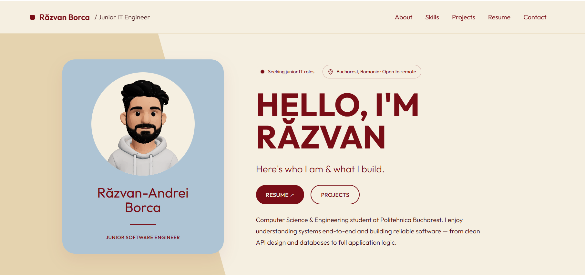

<div align="center">

# Răzvan-Andrei Borca — Portfolio

Personal portfolio of a Computer Engineering student and aspiring junior software engineer, with an interactive 3D avatar and smooth-scrolling single-page layout.

**[🌐 Live site](https://www.borcarazvan.tech/)** · **[💼 LinkedIn](https://www.linkedin.com/in/borca-razvan-andrei/)**



</div>

---

## About

This is the source code for my personal portfolio at [borcarazvan.tech](https://www.borcarazvan.tech/). I'm a Computer Engineering student at University Politehnica of Bucharest, interested in backend, embedded and systems programming. The site presents who I am, what I know, and the projects I've built.

## Features

- **Interactive 3D avatar** in the hero section, rendered with React Three Fiber
- **Static avatar fallback on phones**, so mobile visitors get a fast, lightweight page instead of a heavy WebGL scene
- **Smooth scrolling** powered by Lenis
- **Single-page layout** with five sections: Hero, About, Skills & Background, Projects, Contact
- **Custom palette** in burgundy, cream, sand and dusty tones
- **Downloadable CV** served as a static PDF

## Tech Stack

| Area | Tools |
| --- | --- |
| Framework | [Next.js 16](https://nextjs.org/) (Turbopack) |
| Styling | [Tailwind CSS](https://tailwindcss.com/) |
| 3D | [React Three Fiber](https://r3f.docs.pmnd.rs/) |
| Scrolling | [Lenis](https://lenis.darkroom.engineering/) |
| Hosting | <your hosting platform> |

## Featured Projects

- **[Inventory Manager](https://github.com/RazvanAndrei2005/inventory-manager)**: Spring Boot inventory management application, backed by PostgreSQL (in progress).
- **[Smart Pet Feeder](https://github.com/RazvanAndrei2005/Smart-Pet-Feeder)**: automatic pet feeder written in async Rust on a Raspberry Pi Pico 2 W.

## Getting Started

### Prerequisites

- [Node.js](https://nodejs.org/) (use a version supported by Next.js 16)
- npm, pnpm or yarn

### Installation

```bash
# Clone the repository
git clone https://github.com/RazvanAndrei2005/<repo-name>.git
cd <repo-name>

# Install dependencies
npm install

# Start the development server
npm run dev
```

Then open [http://localhost:3000](http://localhost:3000).

### Production build

```bash
npm run build
npm start
```

## Assets

- **3D avatar:** `public/avatar/avatar.glb`
- **Static avatar (mobile):** PNG fallback in `public/avatar/`
- **CV:** `public/Razvan-Borca-CV.pdf`

To use your own avatar, replace the `.glb` file and the fallback image with your own.

## Deployment

The site is deployed at [borcarazvan.tech](https://www.borcarazvan.tech/). <Add one line about how it's deployed, e.g. "Hosted on X, with automatic deploys from the `main` branch.">

## Contact

- Portfolio: [borcarazvan.tech](https://www.borcarazvan.tech/)
- LinkedIn: [borca-razvan-andrei](https://www.linkedin.com/in/borca-razvan-andrei/)
- GitHub: [@RazvanAndrei2005](https://github.com/RazvanAndrei2005)

## License

This project is licensed under the [MIT License](./LICENSE).

The code is MIT licensed. Personal content (text, images, avatar, CV) is not covered and may not be reused.
